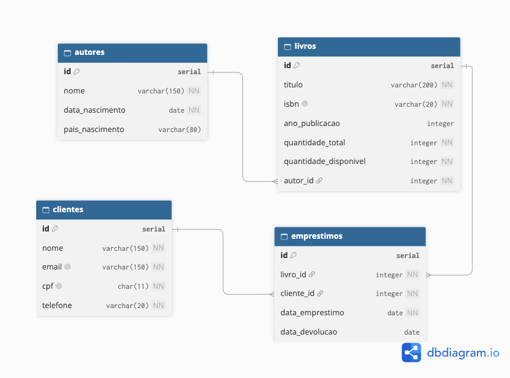

# BookStore Manager CLI
 
Sistema de gerenciamento de livraria com Node.js e TypeScript, executado pelo terminal, com banco de dados modelado em PostgreSQL.
 
## Sobre o projeto
 
O BookStore Manager CLI é uma aplicação de terminal que informatiza o controle de uma pequena livraria. Por meio de menus interativos, ela permite gerenciar autores, livros, clientes e empréstimos, aplicando regras de negócio que mantêm os dados consistentes: um livro só pode ser cadastrado para um autor existente, um empréstimo só acontece se houver exemplar disponível e não é possível remover registros que tenham vínculos.
 
Os dados são mantidos em memória durante a execução e carregados a partir de um conjunto de dados iniciais (seed). Em paralelo, o banco de dados da livraria foi modelado em um Diagrama Entidade-Relacionamento (DER) e implementado no PostgreSQL pelo arquivo `database/script.sql`, que reúne a criação das tabelas, a manipulação dos dados e os relatórios gerenciais.
 
A aplicação não se conecta ao banco de dados: o banco é executado separadamente, diretamente no PostgreSQL.
 
## Objetivo
 
Aplicar em um projeto completo os conteúdos do Módulo 01 do curso Desenvolvedor(a) Back End Node da Carreira Tech do SENAI: Node.js, TypeScript, Programação Orientada a Objetos (interfaces, classes, herança e modificadores de acesso), programação assíncrona com async/await, arquitetura em camadas, Clean Code e SOLID, modelagem de banco de dados relacional, SQL (DDL, DML e consultas com JOIN, GROUP BY, ORDER BY, LIMIT e agregação), Git, GitHub, GitFlow e Kanban.
 
## Tecnologias utilizadas
 
- Node.js
- TypeScript
- tsx
- readline (módulo nativo do Node.js)
- PostgreSQL
- pgAdmin
- dbdiagram.io
- Prettier
- Git e GitHub
## Pré-requisitos
 
- Node.js (versão LTS)
- npm
- Git
- PostgreSQL (testado na versão 18)
- pgAdmin (opcional, para executar o script SQL e visualizar os relatórios)
## Como instalar
 
Clone o repositório:
 
```bash
git clone https://github.com/Matkalil/bookstore-manager-cli.git
```
 
Acesse a pasta do projeto:
 
```bash
cd bookstore-manager-cli
```
 
Instale as dependências:
 
```bash
npm install
```
 
Nas versões mais recentes do npm, podem aparecer avisos `npm warn allow-scripts` sobre os pacotes `esbuild` e `fsevents`. Eles são apenas informativos e não impedem a execução do projeto.
 
## Como executar
 
```bash
npm run dev
```
 
O menu principal é exibido no terminal. Digite o número da opção desejada e pressione Enter. A opção `0` volta ao menu anterior ou encerra a aplicação.
 
Scripts disponíveis:
 
| Script | Descrição |
|---|---|
| `npm run dev` | Executa a aplicação diretamente a partir do TypeScript |
| `npm run build` | Compila o TypeScript para JavaScript na pasta `dist` |
| `npm start` | Executa a versão compilada com Node.js (requer `npm run build` antes) |
| `npm run typecheck` | Verifica erros de tipagem sem gerar arquivos |
 
## Banco de dados
 
### Diagrama Entidade-Relacionamento
 

 
O banco possui quatro tabelas:
 
| Tabela | Relacionamentos |
|---|---|
| `autores` | Um autor possui vários livros (1:N) |
| `livros` | Pertence a um autor e possui vários empréstimos (1:N) |
| `clientes` | Um cliente possui vários empréstimos (1:N) |
| `emprestimos` | Pertence a um livro e a um cliente |
 
No diagrama, o traço indica o lado 1 do relacionamento e o "pé de galinha" indica o lado N. O arquivo-fonte do diagrama está em `database/der-bookstore.dbml` e pode ser aberto no [dbdiagram.io](https://dbdiagram.io).
 
As tabelas usam chaves primárias (`SERIAL PRIMARY KEY`), chaves estrangeiras e as restrições `NOT NULL`, `UNIQUE` (ISBN, e-mail e CPF) e `CHECK` (data de nascimento anterior à data atual, ano de publicação positivo, quantidade total maior que zero, quantidade disponível entre zero e o total, e data de devolução igual ou posterior à data do empréstimo).
 
### Como executar o script SQL
 
O arquivo `database/script.sql` está organizado em três seções: **DDL** (criação da estrutura), **DML** (inserção, atualização e remoção de dados) e **Relatórios**. Ele deve ser executado por inteiro.
 
Pelo pgAdmin:
 
1. Conecte-se ao servidor PostgreSQL.
2. Clique com o botão direito em **Databases → Create → Database...** e crie um banco chamado `bookstore`.
3. Selecione o banco `bookstore` e abra o **Query Tool**.
4. Abra o arquivo `database/script.sql` ou cole o seu conteúdo.
5. Sem selecionar nenhum trecho, execute com **F5**.
Pelo terminal (psql):
 
```bash
psql -U postgres -c "CREATE DATABASE bookstore;"
psql -U postgres -d bookstore -f database/script.sql
```
 
O script pode ser executado quantas vezes for necessário, porque o `DROP TABLE IF EXISTS` recria a estrutura a cada execução. Na primeira vez, aparecem avisos (`NOTICE`) informando que as tabelas ainda não existiam, o que é esperado.
 
Os `INSERT` usam os mesmos dados do seed da aplicação. Em seguida, os exemplos de DML atualizam o telefone da cliente de ID 5 e removem o cliente de ID 6, que não possui empréstimos. Por isso, ao final do script, o banco tem 5 clientes, enquanto a aplicação inicia com os 6 do seed.
 
### Relatórios
 
Para ver o resultado de um relatório no pgAdmin, selecione apenas a consulta desejada e pressione **F5**.
 
| Relatório | Recursos utilizados |
|---|---|
| Livros disponíveis | `INNER JOIN`, `WHERE`, `ORDER BY` |
| Livros emprestados | `INNER JOIN` com três tabelas, `IS NULL`, `ORDER BY` |
| Livros cadastrados por autor | `LEFT JOIN`, `COUNT`, `GROUP BY`, `ORDER BY` |
| Quantidade de empréstimos por livro | `LEFT JOIN`, `COUNT`, `GROUP BY`, `ORDER BY`, `LIMIT` |
| Clientes com empréstimos ativos | `INNER JOIN`, `IS NULL`, `COUNT`, `GROUP BY`, `ORDER BY` |
 
O `LEFT JOIN` garante que autores sem livros e livros nunca emprestados também apareçam nos relatórios, com contagem zero.
 
## Funcionalidades
 
- Cadastrar, listar, consultar por ID, atualizar e remover autores, livros e clientes
- Realizar empréstimos, validando a existência do cliente, a existência do livro e a disponibilidade de exemplares
- Registrar devoluções, atualizando a quantidade disponível do livro
- Listar e consultar empréstimos com o título do livro, o nome do cliente e as datas
- Exigir que todo livro esteja vinculado a um autor cadastrado
- Impedir ISBN, e-mail e CPF duplicados
- Validar datas (formato `dd/mm/aaaa`, data existente e anterior à data atual), e-mail, CPF, ano de publicação e quantidade de exemplares
- Preservar os exemplares emprestados ao atualizar a quantidade total de um livro
- Impedir a devolução de um empréstimo já devolvido
- Impedir a remoção de autores com livros e de livros ou clientes com empréstimos registrados
- Exibir mensagens claras para erros, sem interromper a aplicação
## Exemplos de execução
 
### Menu principal
 
Saída obtida:
 
```
Bem-vindo ao BookStore Manager CLI!
 
===== MENU PRINCIPAL =====
1. Autores
2. Livros
3. Clientes
4. Empréstimos
0. Encerrar aplicação
Escolha uma opção:
```
 
### Listagem de livros
 
Saída obtida:
 
```
#1 - Cavernas de Aço | ISBN: 9780000000011 | Ano: 1954 | Disponíveis: 2/3 | Autor ID: 1
#2 - O Fim da Eternidade | ISBN: 9780000000028 | Ano: 1955 | Disponíveis: 2/2 | Autor ID: 1
#8 - A Paixão Segundo G.H. | ISBN: 9780000000080 | Ano: 1964 | Disponíveis: 0/1 | Autor ID: 5
```
 
### Empréstimo de livro indisponível
 
Entrada testada:
 
```
ID do livro: 8
ID do cliente: 1
```
 
Saída obtida:
 
```
[ERRO] O livro "A Paixão Segundo G.H." não possui exemplares disponíveis.
```
 
### Devolução e novo empréstimo
 
Entrada testada:
 
```
Registrar devolução do empréstimo 6
Realizar empréstimo do livro 8 para o cliente 1
```
 
Saída obtida:
 
```
[OK] Devolução do empréstimo 6 registrada.
[OK] Empréstimo registrado com o ID 7.
```
 
### Listagem de empréstimos
 
Saída obtida:
 
```
#3 - Cavernas de Aço | Cliente: Iracema Valadares | Empréstimo: 05/10/2026 | Devolução: pendente
#6 - A Paixão Segundo G.H. | Cliente: Otávio Scarpellini | Empréstimo: 18/10/2026 | Devolução: 30/10/2026
#7 - A Paixão Segundo G.H. | Cliente: Iracema Valadares | Empréstimo: 30/10/2026 | Devolução: pendente
```
 
### Registro inexistente
 
Entrada testada:
 
```
Consultar autor de ID 99
```
 
Saída obtida:
 
```
[ERRO] Autor com ID 99 não encontrado.
```
 
### Data inválida
 
Entrada testada:
 
```
Data de nascimento: 31/02/2000
```
 
Saída obtida:
 
```
[ERRO] Data de nascimento inválida. Use o formato dd/mm/aaaa.
```
 
### Duplicidade
 
Entrada testada:
 
```
Cadastrar livro com o ISBN 9780000000011
Cadastrar cliente com o e-mail iracema.valadares@email.com
```
 
Saída obtida:
 
```
[ERRO] Já existe um livro cadastrado com o ISBN 9780000000011.
[ERRO] Já existe um cliente cadastrado com o e-mail iracema.valadares@email.com.
```
 
### Remoção com vínculo
 
Entrada testada:
 
```
Remover o cliente de ID 1
```
 
Saída obtida:
 
```
[ERRO] Não é possível remover o cliente: existem empréstimos registrados para ele.
```
 
### Entrada inválida no menu
 
Entrada testada:
 
```
abc
```
 
Saída obtida:
 
```
[ERRO] Digite um número inteiro válido.
```
 
## Arquitetura do projeto
 
A aplicação segue uma arquitetura em camadas. Cada camada tem uma responsabilidade única e se comunica apenas com a camada seguinte:
 
```
main.ts → menus → controllers → services → repositories → models
```
 
| Camada | Responsabilidade |
|---|---|
| Main | Carrega o seed, cria as camadas com injeção de dependência e inicia o menu principal |
| Menus | Organizam as opções de navegação de cada módulo |
| Controllers | Fazem as perguntas ao usuário, acionam os services e exibem os resultados ou erros |
| Services | Aplicam as regras de negócio e as validações antes de qualquer alteração |
| Repositories | São os únicos responsáveis por armazenar e recuperar os dados em memória |
| Models | Representam as entidades com interfaces e classes |
| Utils | Reúnem funções reutilizáveis de terminal, validação e datas |
 
## Estrutura do projeto
 
```
bookstore-manager-cli/
│
├── database/
│   ├── der-bookstore.dbml
│   ├── der-bookstore.png
│   └── script.sql
│
├── src/
│   ├── main.ts
│   ├── controllers/
│   │   ├── AutorController.ts
│   │   ├── ClienteController.ts
│   │   ├── EmprestimoController.ts
│   │   └── LivroController.ts
│   ├── data/
│   │   └── seed.ts
│   ├── menus/
│   │   ├── executarMenu.ts
│   │   ├── menuAutores.ts
│   │   ├── menuClientes.ts
│   │   ├── menuEmprestimos.ts
│   │   └── menuLivros.ts
│   ├── models/
│   │   ├── Autor.ts
│   │   ├── Cliente.ts
│   │   ├── Emprestimo.ts
│   │   └── Livro.ts
│   ├── repositories/
│   │   ├── AutorRepository.ts
│   │   ├── ClienteRepository.ts
│   │   ├── EmprestimoRepository.ts
│   │   ├── LivroRepository.ts
│   │   └── RepositorioEmMemoria.ts
│   ├── services/
│   │   ├── AutorService.ts
│   │   ├── ClienteService.ts
│   │   ├── EmprestimoService.ts
│   │   └── LivroService.ts
│   └── utils/
│       ├── datas.ts
│       ├── terminal.ts
│       └── validacoes.ts
│
├── .gitignore
├── .prettierrc
├── LICENSE
├── package.json
├── package-lock.json
├── tsconfig.json
└── README.md
```
 
### Explicação dos arquivos
 
| Arquivo | Responsabilidade |
|---|---|
| `database/script.sql` | Script do banco: DDL, DML e as consultas dos relatórios |
| `database/der-bookstore.png` | Imagem do Diagrama Entidade-Relacionamento |
| `database/der-bookstore.dbml` | Arquivo-fonte do DER, editável no dbdiagram.io |
| `src/main.ts` | Ponto de entrada. Carrega o seed, monta as camadas e inicia o menu principal |
| `src/controllers/` | Camada de interface com o usuário de cada módulo |
| `src/data/seed.ts` | Dados iniciais da aplicação, idênticos aos `INSERT` do `script.sql` |
| `src/menus/executarMenu.ts` | Laço de navegação reutilizado por todos os menus |
| `src/menus/menu*.ts` | Opções de cada menu e as ações do controller correspondente |
| `src/models/` | Interfaces e classes das entidades. `Livro` possui o método `estaDisponivel` e `Emprestimo`, o método `estaAtivo` |
| `src/repositories/RepositorioEmMemoria.ts` | Classe genérica com as operações de listar, buscar, gerar ID, salvar e remover |
| `src/repositories/*Repository.ts` | Repositórios de cada entidade, que herdam do repositório genérico |
| `src/services/` | Regras de negócio e validações de cada módulo |
| `src/utils/terminal.ts` | Leitura de textos e números no terminal e exibição de erros |
| `src/utils/validacoes.ts` | Funções puras de validação: texto, e-mail, CPF, quantidade e ano |
| `src/utils/datas.ts` | Conversão de texto `dd/mm/aaaa` para data e formatação de datas |
| `.prettierrc` | Padronização da formatação do código (aspas simples) |
| `tsconfig.json` | Configuração do compilador TypeScript em modo estrito (`strict`) |
| `package.json` | Scripts e dependências de desenvolvimento do projeto |
 
## Conceitos aplicados
 
### TypeScript, interfaces e classes
 
Cada entidade possui uma interface (`IAutor`, `ILivro`, `ICliente`, `IEmprestimo`) e uma classe que a implementa. Os atributos são tipados, o `id` é `readonly` e os campos opcionais acompanham as colunas que aceitam nulo no banco, como o ano de publicação e a data de devolução (`Date | null`). Todos os métodos têm parâmetros e retornos tipados, e o projeto roda em modo `strict`.
 
### Modificadores de acesso
 
Os três modificadores são utilizados: `public` nos métodos que outras camadas chamam, `private` nos atributos injetados e nos métodos auxiliares, como `validarDados` e `formatarLivro`, e `protected` na lista de registros do repositório genérico, acessível apenas por ele e por suas classes filhas.
 
### Herança e generics
 
A classe abstrata `RepositorioEmMemoria<T>` implementa uma única vez as operações de armazenamento. Os quatro repositórios herdam dela com `extends`, informando o tipo da entidade, o que evita duplicar o mesmo código quatro vezes. O gerador de IDs funciona como o `SERIAL` do PostgreSQL: o contador nunca reaproveita o ID de um registro removido.
 
### Programação assíncrona
 
Todos os métodos de services e repositories são `async` e retornam `Promise`, com chamadas feitas por `await`. Isso prepara a aplicação para uma futura integração com o banco de dados. A listagem de empréstimos usa `Promise.all` para buscar o livro e o cliente de cada empréstimo.
 
### Tratamento de erros
 
Os services validam os dados e lançam erros com mensagens claras (`throw new Error`). Os controllers capturam esses erros com `try/catch` e os exibem com a função `exibirErro`, de modo que nenhuma entrada inválida interrompe a aplicação. A leitura de números repete a pergunta até receber um valor válido.
 
### Regras de negócio e coerência com o banco
 
As restrições do banco foram reproduzidas nos services: o `UNIQUE` virou a verificação de ISBN, e-mail e CPF duplicados; o `CHECK`, as validações de valores; e a chave estrangeira, a verificação de que o autor, o livro ou o cliente existe. A remoção de registros com vínculos também é bloqueada, assim como o PostgreSQL faz com as chaves estrangeiras. Todas as verificações acontecem antes de qualquer alteração nos dados.
 
### Métodos de array
 
| Método | Onde foi usado |
|---|---|
| `find` | Buscar um registro pelo ID |
| `findIndex` | Localizar o registro a ser substituído ao salvar |
| `filter` | Remover um registro pelo ID |
| `some` | Verificar duplicidades e vínculos antes de remover |
| `map` | Montar a listagem detalhada de empréstimos |
| `forEach` | Exibir os registros nas listagens |
| `reduce` | Encontrar o maior ID do seed para iniciar o gerador de IDs |
 
### Injeção de dependência
 
O `main.ts` cria os repositórios, os services e os controllers, entregando cada dependência pelo construtor. O `LivroService` recebe o `AutorService` para validar o autor, e o `EmprestimoService` recebe o `LivroService` e o `ClienteService`. Assim, cada classe usa suas dependências sem precisar saber como elas são criadas.
 
## Organização do Kanban
 
As tarefas foram organizadas no GitHub Projects, com as colunas To do, In progress,  e Done. Cada etapa foi registrada como Issue e fechada pelo Pull Request correspondente.
 
[Acessar o quadro Kanban](https://github.com/users/Matkalil/projects/6/views/1)
 
## Branches utilizadas
 
| Branch | Objetivo |
|---|---|
| `main` | Versão estável e entregável do projeto |
| `develop` | Integração das funcionalidades antes de irem para a `main` |
| `feat/banco-dados` | DER e script SQL (DDL, DML e relatórios) |
| `feat/estrutura-inicial` | Configuração do projeto, models, seed e utils |
| `feat/autores` | Gerenciamento de autores, repositório genérico e menu principal |
| `feat/livros` | Gerenciamento de livros |
| `feat/clientes` | Gerenciamento de clientes |
| `feat/emprestimos` | Empréstimos, devoluções e bloqueio de remoções com vínculo |
| `fix/revisao-geral` | Correções encontradas no teste geral |
| `fix/ajustes-banco` | Correções no script SQL e no DER |
| `docs/readme` | Escrita da documentação |
 
## Vídeo de apresentação
 
Em breve.
 
## Melhorias futuras
 
- Integrar a aplicação ao PostgreSQL, substituindo os repositórios em memória
- Exibir os relatórios gerenciais também na aplicação
- Formatar automaticamente o telefone no padrão `(DD) 99999-9999`
- Registrar uma data prevista de devolução e identificar empréstimos atrasados
- Validar o CPF pelos dígitos verificadores
- Criar testes automatizados
- Atualizar dado específico sem a necessidade de atualizar todas as informações
## Integrantes
 
- Mateus Kuhnen Kalil ([@Matkalil](https://github.com/Matkalil))
 